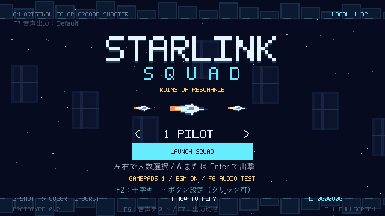

# 最新：Windows音楽統合版0.4

**ソースから起動する前に `node tools/build_story_music.cjs` を実行し、Godotで再インポートしてください。** 4場面の音楽を更新しending.wavを生成します。配布ZIPは生成済み。[音楽・ボス調整と検証](docs/AUDIO_RELEASE.md)。

# 最新：Windows物語導入版0.3

起動すると約51秒のプロローグから始まります。Enter/Aで次へ、Esc/Startでスキップ。スーファミ寄りの陰影・多層背景へ調整中。[今回の仕様と検証](docs/PROLOGUE.md)。ブラウザー版は browser-prototype/ に保管。以下は基礎となる0.2の説明です。

# STARLINK SQUAD — Ruins of Resonance

Godot 4.6 / Windows向け、1〜3人ローカル協力の横スクロールSTG。
ファミコン風のドット絵・オリジナルBGM・軽いパズルを組み合わせた、**開発中の初期版0.2**です。
将来Steamでの販売を目指しています。Steam連携・オンラインランキングは未実装です。

## GPT・開発者が最初に読むもの

1. [HANDOFF.md](HANDOFF.md)：決定事項、現状、ユーザー報告、次の作業。
2. [docs/DEVELOPMENT.md](docs/DEVELOPMENT.md)：起動・再生成・テスト。
3. [docs/CHANGELOG.md](docs/CHANGELOG.md)：変更履歴。
4. `game.gd`：ゲームロジック・入力・描画・音楽再生。

## ソースから起動

Godot **4.6 Standard** で `project.godot` を開き、F6ではなく **F5（プロジェクト実行）**。
公式エンジン：https://godotengine.org/download/archive/4.6-stable/

このソース一式にはエンジン本体・実行用PCK・セーブデータを含めていません。
先に渡したWindowsプレイ用ZIPにはエンジンが同梱され、`START.cmd` で起動できます。
ソースを変更しても、別フォルダーのプレイ用PCKは自動更新されません。

## 操作

タイトルで左右を押して1〜3人を選び、AまたはEnterで出撃。
パッド：スティック／十字キーで移動、A/RTでショット、Xで色変更、Bでバースト、Startでポーズ。
機種によりボタン表記が異なります。

**十字キーが効かない場合：タイトルのF2、または「十字キー・ボタン設定」をクリックし、上下左右と4ボタンを登録。**
登録したコントローラーは決定ボタンを一度離してから再度押してください。
キーボード：P1は矢印/Z/X/C、P2はWASD/R/F/G、P3はIJKL/U/O/N。

音が出ない場合は **F6（音声テスト・ミュート解除）→F7（出力先を切り替え）**。
タイトル左上の出力先表示を確認してください。Mで音声ON/OFF、F11で全画面。
Windows側の音量・アプリ音量が0なら、ゲーム内の設定だけでは音が聞こえません。

## 実装内容

- 1ステージ、色を合わせて撃つパズル2種類、色付きの弱点を持つボス1体。
- 仲間の救出、共通残機での復帰、バースト、人数別ローカルハイスコア。
- タイトル・通常戦・ボス戦のオリジナルBGM3曲と効果音6種類。
- 1〜3台のゲームパッドを想定。十字キー／ボタンの登録と保存、音声出力先の選択。

## GitHubとGPTでの引き継ぎ

GitHubは最新ソースと変更履歴の保管先、HANDOFF.mdは開発状況を伝える入口です。
GitHubに置くだけで会話内容がGPTへ自動共有されるわけではありません。
利用するChatGPT/Codex側でGitHub接続と対象リポジトリへのアクセスを設定してください。
接続できない場合は、HANDOFF.mdとソース一式をその会話へ添付しても引き継げます。
参考：[OpenAI公式・プラグインの利用](https://learn.chatgpt.com/docs/plugins)

次のGPTに渡す文章：

> このリポジトリのHANDOFF.md、README.md、AGENTS.md、docs/CHANGELOG.mdを読んでから続けてください。Steam販売を目指す1〜3人ローカル協力STGです。最新の課題はコントローラーの十字キーと無音の実機再確認です。実装済みと予定、実測と推測を区別し、変更後は申し送りも更新してください。

保存先：https://github.com/coshimagame/starlink-squad （Private）。
このリポジトリは修正版0.2のソース・音楽・引き継ぎ資料を管理します。Windowsプレイ用ZIPは別配布です。

## ライセンス表記

GODOT-LICENSE.txt / GODOT-COPYRIGHT.txt はGodotエンジンの表記です。
ゲーム全体へのオープンソースライセンスの付与は、現時点では行っていません。
