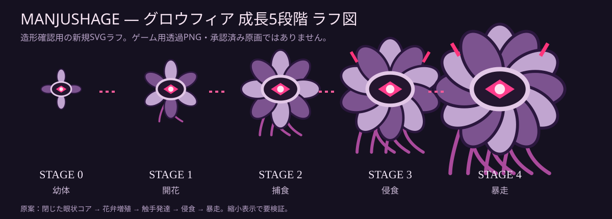

# ビジュアル企画書：時間経過で成長する敵「グロウフィア」（仮）

- 作成日：2026-11-16
- 対象：Steam向けSTG『曼珠沙華（MANJUSHAGE）』
- 状態：**提案・コンセプト**。敵名、数値、採用、素材、実装、テストは未確定。
- 重要：**5段階の新規SVGラフ画はGitHubに登録済み**。ただしチャットで先に生成したビジュアル企画画像そのものはリポジトリ未収録。SVGラフはゲーム用透過PNG・正式採用原画ではない。

## ラフ画（Codex必読・実ファイルあり）

**Codexへの明示指示：実装・スプライト制作前に必ず [`GROWING_ENEMY_VISUAL_ROUGH.svg`](GROWING_ENEMY_VISUAL_ROUGH.svg) を開いて参照すること。** 眼状コア、増殖する花弁、触手、侵食・暴走への段階変化を外見の基準とし、これと無関係な敵デザインに置き換えない。画像は新規作成した簡易SVGラフであり、チャットで生成した元の大型ビジュアル企画画像の完全複製ではない。正式採用は未決。ゲーム用の独立透過PNGは別途制作・検証する。

## コンセプト
敵を倒さずにいると、その場で生体装甲・花弁・触手・発光器官が段階的に発達し、攻撃が強化される。早期撃破は安全、危険を承知で成長させると高得点・希少アイテムを狙える、リスクと報酬の選択を生む。世界観は「生体宇宙・機械との融合・曼珠沙華・暗い宇宙」。既存の正式キャラクター外観は変更しない。

## 5段階のビジュアルとゲームプレイ案

| 段階 | 経過時間（仮） | 外見・アニメーション | 攻撃・役割（仮） |
| --- | --- | --- | --- |
| 0 幼体 | 出現時 | 小さな眼状コアと閉じた花弁。読みやすい小型シルエット | 単発の低速弾 |
| 1 開花 | 10秒 | 花弁が左右に展開し、外殻が拡大 | 3方向弾 |
| 2 捕食 | 20秒 | 触手が伸び、コアが発光。明瞭な中型シルエット | 追尾弾追加 |
| 3 侵食 | 35秒 | 多層花弁、赤い脈動、周辺への胞子・オーラ | 周囲の敵を強化、密度の高い弾幕 |
| 4 暴走 | 50秒 | 大型の曼珠沙華状の怪物へ変異。裂けた花弁と長い触手 | 中ボス級。広域攻撃・場への影響 |

時間・性能はゲームバランス調整前の仮値。画面外やスクロール中の成長・デスポーン・上限は未決。段階4でも画面を埋めすぎず、プレイヤー・弾・アイテムの視認性を最優先。

## グラフィック制作仕様
- Godot 4.6、基準画面640×360。横スクロール・縦スクロール両方で視認性を確認。
- 5段階それぞれ**独立した真のアルファ透過PNG**。段階ごとの待機、開花・変異、攻撃、被弾、撃破のアニメーションを別途検討。
- 生成画像の市松模様や背景を透過と誤認しない。縮小表示時にも輪郭・中心コア・敵弾が判別できるようにする。
- 個別PNG、独立利用可能なスプライトシート、素材一覧（名前・用途・寸法・ファイル名・フレーム座標）、原画・生成元・権利・承認状態を記録。
- **既存の原画と承認済みデザインを上書きしない。** 新規素材は仮名で追加し、参照は差し替え可能なスロット方式を使う。
- 企画画像は見た目の方向性のみ。ゲーム素材として切り出し済み・登録済みとは記さない。

## Codexへの実装依頼（未実装）
1. 現行の敵生成・当たり判定・弾幕・アイテム・描画・ステージスクロールのコードを調査。
2. 既存の敵を壊さず、独立した成長型敵として段階状態・経過時間・攻撃パターンを仮実装。画像が未収録なら仮描画を使用。
3. 各段階の明確な予告エフェクトと、撃破時の得点・ドロップの段階差を実装・調整。
4. 1〜3人プレイ、縦横スクロール、保存・ゲームパッド、弾幕視認性、パフォーマンスをGodot 4.6で検証。
5. 実装結果、実ゲームスクリーンショット、テスト結果、未実装項目を記録。文書作成のみで「実装済み」としない。

## 参照画像の受け渡し
本書にリンクした**5段階のSVGラフはGitHubに登録済み**であり、Codexは必ず参照する。先にChatGPT会話で生成した詳細なビジュアル企画画像のPNGバイナリは未登録であり、SVGラフと混同しないこと。SVGは造形指示用でゲーム用透過PNGではない。実装には別途透過素材を作り、承認済みの絵と混同しないこと。
