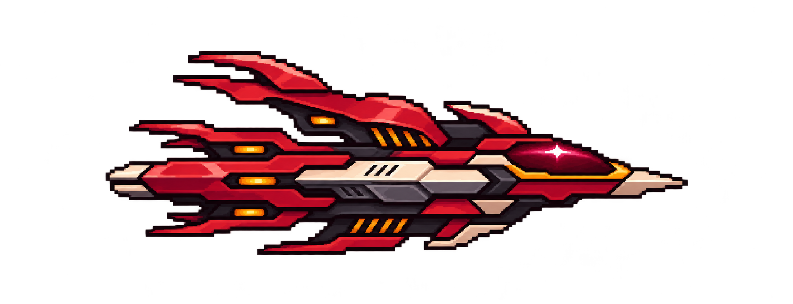
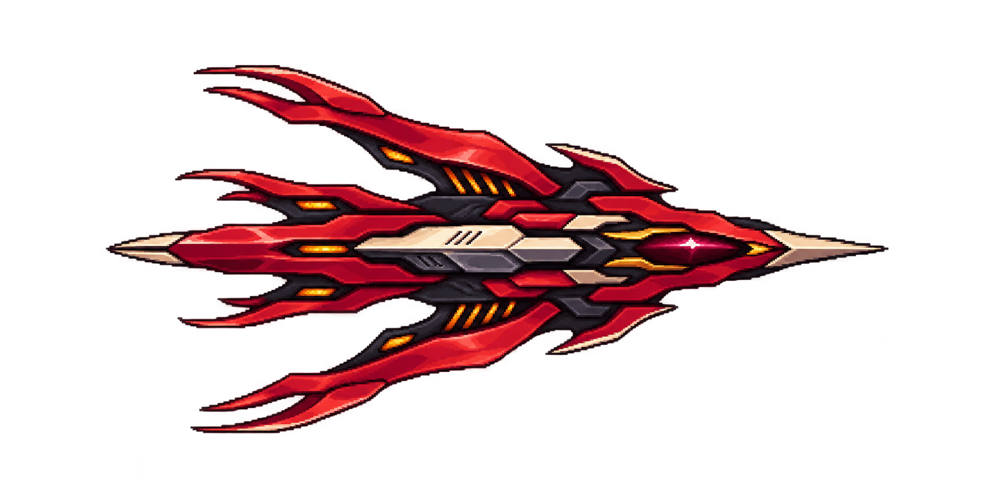
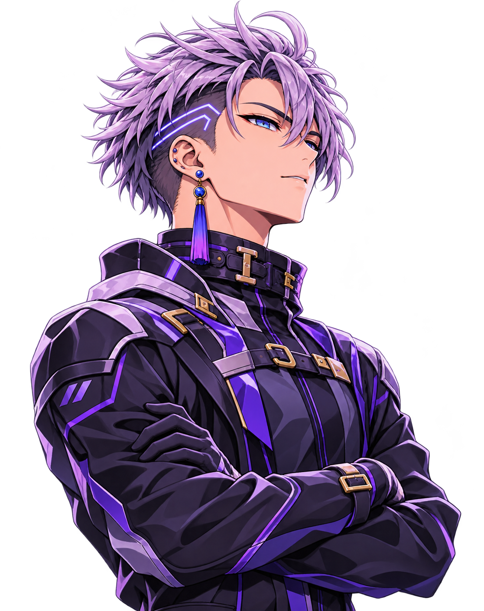
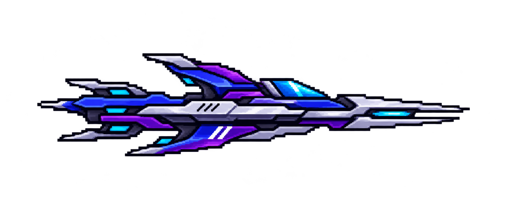
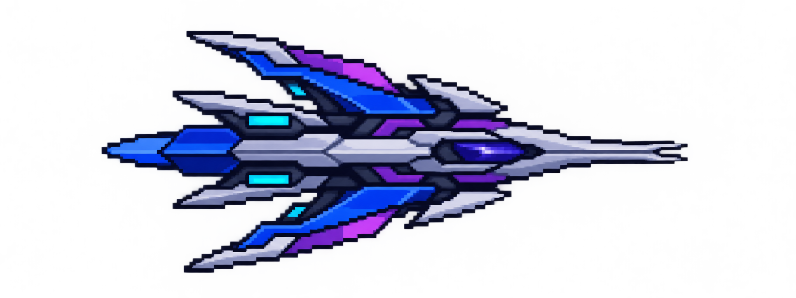
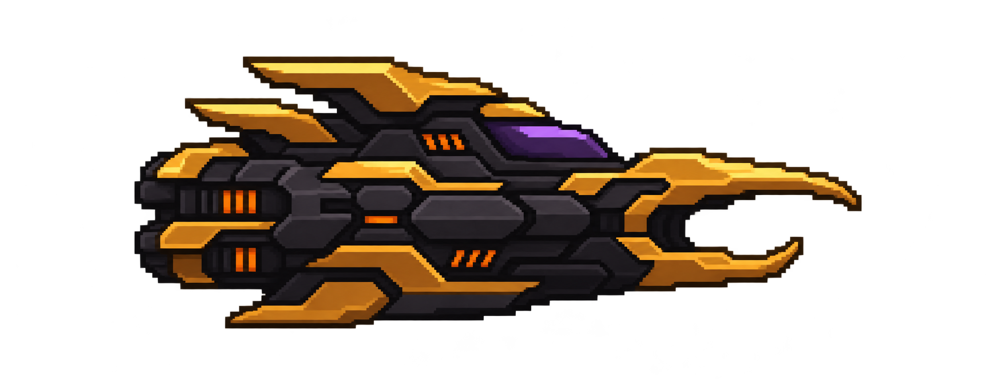
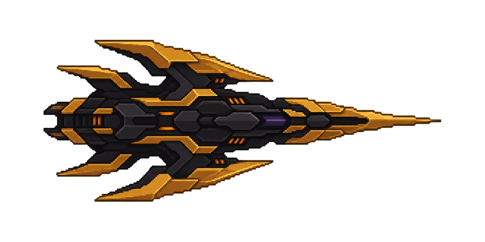

# 3人の人物原本と試遊版の自機

『曼珠沙華』Godot 0.9 用。ブランチ `playtest/stage1-v09-20261119`。人物はユーザーが基本に指定した透過原本、機体は横スクロールと縦スクロールでゲームが選ぶ素材。画像名を押すと原本を開ける。

| 操縦士 | 人物の基準画像 | 横スクロール機 | 縦スクロール機 |
| --- | --- | --- | --- |
| **コルミィ** 赤い髪、白い花飾り、こちらへ伸ばした黒手袋 |  | [ cormii_muu_v02_h.png](../../art/active/ships/cormii_muu_v02_h.png) | [ cormii_muu_v02_v.png](../../art/active/ships/cormii_muu_v02_v.png) |
| **ジヨーザ** 淡い紫の短髪、青い瞳、紫の房飾りと耳飾り |  | [ jiyoza_muu_v02_h.png](../../art/active/ships/jiyoza_muu_v02_h.png) | [ jiyoza_muu_v02_v.png](../../art/active/ships/jiyoza_muu_v02_v.png) |
| **マフィオ** 白と濃紫に分かれた髪、金の瞳、黄色のリボンとヘッドホン |  | [ mafio_gold_black_v03_h.png](../../art/active/ships/mafio_gold_black_v03_h.png) | [ mafio_gold_black_v02.png](../../art/active/ships/mafio_gold_black_v02.png) |

3人とも造形を追うときはこの人物原本から始める。マフィオの金×黒の上面図は `mafio_gold_black_v02.png`。ファイル名に `_v` が付かない。機体の配列順はコルミィ・ジヨーザ・マフィオ。

## ゲーム側の参照

- [art_catalog.gd](../../art_catalog.gd) の `portrait()` が原本を小さいドット表示に縮小する。プロローグ・幕間・ステータスはこの対応表を共有する。
- 同じファイルの `reference_ship()` が各機体の横・縦素材と余白を除く範囲を選ぶ。[visual_v09.gd](../../visual_v09.gd) の `ship()` がスクロール方向に合わせて描画する。
- [機体の制作台帳](../../art/active/ships/README.md)・[人物原本と以前のドット版の来歴](../../art/active/pilots/README.md)・[機体別の能力](../../pilot_abilities.gd)

## 640×360のゲーム内表示

[コルミィの幕間](../screenshots/latest/intermission_cormii_20261121.png)・[ジヨーザの幕間](../screenshots/latest/intermission_jiyoza_20261121.png)・[マフィオの幕間](../screenshots/latest/intermission_mafio_20261121.png)
